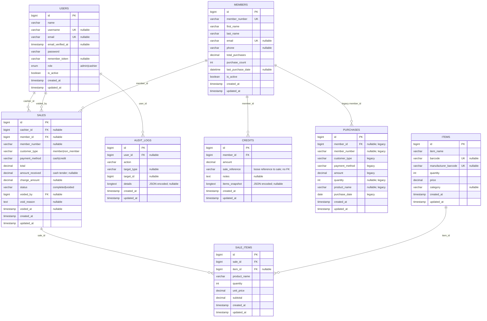

# CoopPOS Entity-Relationship Diagram

Schema reflects the live `coopos` database after credit repayment was removed and the payment-history schema was dropped.

## Legend

| Marking | Meaning |
|---|---|
| Active | Still created or updated by the current application |
| Legacy | Older table still present for backward compatibility or migration history |

`credit_payments`, `credits.amount_paid`, and `credits.status` are no longer part of the schema. Existing credit and payment data was intentionally cleared when the credit ledger was converted to purchase-only records.

## ERD

## Entity notes

| Entity / field | Status | Notes |
|---|---|---|
| `CREDITS` | Active | Purchase-only credit ledger. Each row records a credit sale for a member. |
| `CREDITS.amount` | Active | Amount charged on credit. |
| `CREDITS.sale_reference` | Active | Loose text reference to the related sale; there is no enforced foreign key. |
| `CREDITS.items_snapshot` | Active | JSON snapshot of the items purchased on credit. |
| `PURCHASES` | Legacy | Older purchase table retained for compatibility and migration history. |
| `SALES.payment_method` | Active | Remains `cash` or `credit`; credit sales are still recorded in `sales` and `sale_items`. |
| `CREDIT_PAYMENTS` | Removed | Repayment history table was dropped. |
| `CREDITS.amount_paid` | Removed | Payment tracking column was dropped. |
| `CREDITS.status` | Removed | `unpaid`, `partial`, and `paid` tracking was dropped. |

## Data reset note

All rows in the old `credits` table and the removed `credit_payments` table were discarded. No archive table was created. Users, members, items, sales, sale items, legacy purchases, and audit logs were not cleared.
